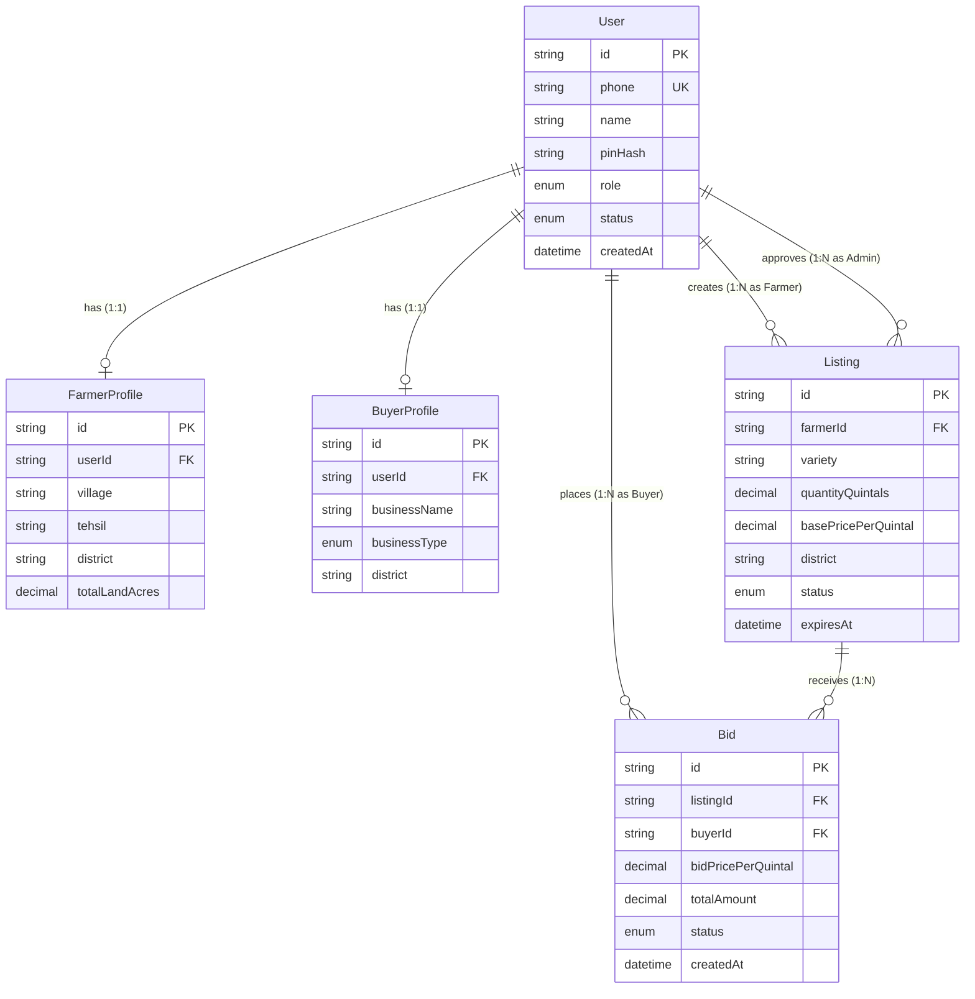
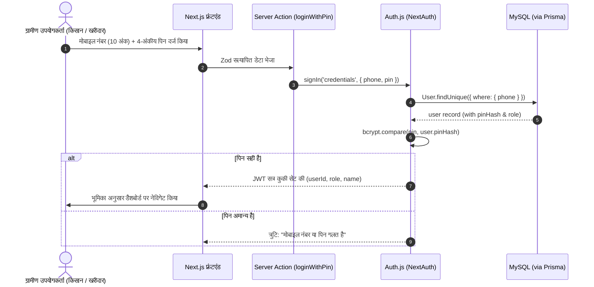

# 🌾 गन्ना हाट (GannaHaat) — संपूर्ण सिस्टम आर्किटेक्चर (Complete System Architecture)
## Phase 1: Architecture & System Design Document

---

### 1. उपयोगकर्ता प्रवाह (User Flows)

```mermaid
flowchart TD
    Start([आगंतुक / Visitor]) --> Choice{क्या खाता है?}
    Choice -->|नहीं| Register["नया खाता बनाएं (पंजीकरण)\nमोबाइल नंबर + 4-अंकीय PIN + भूमिका चयन"]
    Choice -->|हाँ| Login["लॉगिन करें (मोबाइल नंबर + PIN)"]

    Register --> RoleCheck{भूमिका (Role)}
    Login --> RoleCheck

    %% किसान प्रवाह
    RoleCheck -->|🌾 किसान (Farmer)| FarmerDashboard["किसान डैशबोर्ड (मेरी फसलें व बोलियाँ)"]
    FarmerDashboard --> CreateListing["नया गन्ना बेचें (मात्रा, किस्म, भाव, स्थान)"]
    CreateListing --> PendingAdmin["स्थिति: अनुमोदन लंबित (Pending Approval)"]
    PendingAdmin -->|एडमिन स्वीकृत| LiveListing["लाइव मंडी में दृश्यमान"]
    LiveListing --> ReceiveBids["व्यापारियों द्वारा लगाई बोलियाँ देखना"]
    ReceiveBids --> Decision{बोली निर्णय}
    Decision -->|स्वीकार (Accept)| DealClosed["सौदा पक्का (Status: SOLD / ACCEPTED)\nखरीदार का संपर्क अनलॉक"]
    Decision -->|अस्वीकार (Reject)| RejectedBid["बोली अस्वीकृत\nअन्य बोलियों की प्रतीक्षा"]

    %% खरीदार प्रवाह
    RoleCheck -->|🏢 खरीदार (Buyer)| BuyerMarketplace["गन्ना हाट (मंडी) - फसलें ब्राउज़ करें"]
    BuyerMarketplace --> FilterSearch["फ़िल्टर व खोज (ज़िला, किस्म, मात्रा, भाव)"]
    FilterSearch --> ListingDetails["फसल का विस्तार विवरण देखना"]
    ListingDetails --> PlaceBid["बोली लगाएं (दर ₹/क्विंटल >= आधार भाव)"]
    PlaceBid --> MyBids["मेरी बोलियाँ डैशबोर्ड (स्थिति: प्रतीक्षारत)"]
    MyBids --> BidResult{किसान का निर्णय}
    BidResult -->|स्वीकृत| DealSuccess["बधाई! बोली स्वीकृत हुई\nकिसान का संपर्क व खेत का पता अनलॉक"]
    BidResult -->|अस्वीकृत| BidFailed["बोली अस्वीकृत / नई बोली लगाएं"]

    %% एडमिन प्रवाह
    RoleCheck -->|🛡️ एडमिन (Admin)| AdminDashboard["एडमिन डैशबोर्ड (KPIs व मॉनिटरिंग)"]
    AdminDashboard --> ModQueue["नई लिस्टिंग्स अप्रूवल सूची"]
    ModQueue -->|सत्यापित| ApproveAction["अनुमोदित (Approved)"]
    ModQueue -->|अपूर्ण/संदिग्ध| RejectAction["अस्वीकृत (कारण सहित)"]
    AdminDashboard --> UserMgmt["उपयोगकर्ता नियंत्रण (सक्रिय/ब्लॉक)"]
```

---

### 2. डेटाबेस एंटिटीज (Database Entities — MySQL & Prisma)

डेटाबेस स्कीमा रिलेशनल अखंडता (Relational Integrity) और उच्च प्रदर्शन के लिए डिज़ाइन किया गया है:

1. **`User` (उपयोगकर्ता):**
   - `id`: `String` (@id @default(cuid()))
   - `phone`: `String` (@unique) — 10 अंकों का भारतीय मोबाइल नंबर
   - `name`: `String` — पूरा नाम
   - `pinHash`: `String` — Bcrypt से सुरक्षित 4-अंकीय पिन
   - `role`: `Role` (Enum: `FARMER`, `BUYER`, `ADMIN`)
   - `status`: `UserStatus` (Enum: `ACTIVE`, `SUSPENDED`, `PENDING_VERIFICATION`)
   - `createdAt`: `DateTime` (@default(now()))
   - `updatedAt`: `DateTime` (@updatedAt)

2. **`FarmerProfile` (किसान प्रोफ़ाइल):**
   - `id`: `String` (@id @default(cuid()))
   - `userId`: `String` (@unique) — Foreign Key to User
   - `village`: `String` — गाँव
   - `panchayat`: `String?` — ग्राम पंचायत
   - `tehsil`: `String` — तहसील / ब्लॉक
   - `district`: `String` — ज़िला (Indexed)
   - `state`: `String` (@default("उत्तर प्रदेश"))
   - `pincode`: `String?`
   - `totalLandAcres`: `Decimal?` — कुल कृषि भूमि (एकड़ में)
   - `kisanId`: `String?` — किसान क्रेडिट कार्ड / समिति पर्ची संख्या (वैकल्पिक)

3. **`BuyerProfile` (खरीदार / मिल प्रोफ़ाइल):**
   - `id`: `String` (@id @default(cuid()))
   - `userId`: `String` (@unique) — Foreign Key to User
   - `businessName`: `String` — फर्म / मिल / कोल्हू का नाम
   - `businessType`: `BusinessType` (Enum: `SUGAR_MILL`, `JAGGERY_CRUSHER_KOLHU`, `KHANDSARI`, `TRADER_COMMISSION_AGENT`)
   - `gstin`: `String?` — जीएसटी नंबर (वैकल्पिक)
   - `address`: `String` — मिल/व्यापार स्थल का पता
   - `district`: `String` — ज़िला (Indexed)
   - `state`: `String` (@default("उत्तर प्रदेश"))

4. **`Listing` (गन्ने की फसल बिक्री प्रविष्टि):**
   - `id`: `String` (@id @default(cuid()))
   - `farmerId`: `String` — Foreign Key to User (किसान)
   - `variety`: `String` — गन्ने की किस्म (उदा. Co 0238, Co 0118, Co 15023, CoLk 14201, अन्य)
   - `quantityQuintals`: `Decimal` — कुल अनुमानित मात्रा (क्विंटल में)
   - `harvestStatus`: `HarvestStatus` (Enum: `STANDING_CROP`, `FRESHLY_CUT`, `CUT_WITHIN_24HRS`)
   - `harvestDate`: `DateTime?` — अनुमानित कटाई तिथि
   - `basePricePerQuintal`: `Decimal` — न्यूनतम अपेक्षित भाव (₹/क्विंटल)
   - `village`: `String` — खेत का गाँव
   - `tehsil`: `String` — तहसील
   - `district`: `String` — ज़िला (Indexed)
   - `landmark`: `String?` — नजदीकी पहचान स्थल
   - `status`: `ListingStatus` (Enum: `PENDING_APPROVAL`, `APPROVED`, `REJECTED`, `SOLD`, `EXPIRED`, `CANCELLED`)
   - `rejectionReason`: `String?` — अस्वीकृति का कारण (यदि एडमिन अस्वीकृत करे)
   - `approvedAt`: `DateTime?`
   - `approvedById`: `String?` — Foreign Key to User (एडमिन)
   - `expiresAt`: `DateTime` — बोली समाप्त होने की तिथि
   - `createdAt`: `DateTime` (@default(now()))
   - `updatedAt`: `DateTime` (@updatedAt)

5. **`Bid` (लगाई गई बोली):**
   - `id`: `String` (@id @default(cuid()))
   - `listingId`: `String` — Foreign Key to Listing
   - `buyerId`: `String` — Foreign Key to User (खरीदार)
   - `bidPricePerQuintal`: `Decimal` — बोली दर (₹/क्विंटल)
   - `totalAmount`: `Decimal` — कुल अनुमानित मूल्य (`bidPricePerQuintal * quantityQuintals`)
   - `paymentTerms`: `String?` — भुगतान की शर्तें (उदा. "तौल के तुरंत बाद नकद / 24 घंटे में आरटीजीएस")
   - `notes`: `String?` — खरीदार की टिप्पणी / उठान योजना
   - `status`: `BidStatus` (Enum: `PENDING`, `ACCEPTED`, `REJECTED`, `WITHDRAWN`)
   - `createdAt`: `DateTime` (@default(now()))
   - `updatedAt`: `DateTime` (@updatedAt)

---

### 3. एंटिटी संबंध (Entity Relationship Diagram - ERD)



---

### 4. उपयोगकर्ता भूमिकाएँ और अनुमतियाँ (Role-Based Access Control - RBAC)

| क्रिया / एक्शन (Action) | अनाधिकृत (Public) | 🌾 किसान (Farmer) | 🏢 खरीदार (Buyer) | 🛡️ एडमिन (Admin) |
|---|:---:|:---:|:---:|:---:|
| लैंडिंग पेज व लाइव भाव देखना | ✅ | ✅ | ✅ | ✅ |
| पंजीकरण व लॉगिन | ✅ | ✅ | ✅ | ✅ |
| गन्ने की लिस्टिंग बनाना | ❌ | ✅ | ❌ | ❌ |
| अपनी लिस्टिंग संपादित / हटाना | ❌ | ✅ (यदि अप्रूव न हो या नो बिड्स) | ❌ | ✅ |
| लिस्टिंग का अनुमोदन/अस्वीकृति | ❌ | ❌ | ❌ | ✅ |
| स्वीकृत लिस्टिंग्स खोजना/देखना | ❌ | ✅ | ✅ | ✅ |
| बोली लगाना (Place Bid) | ❌ | ❌ | ✅ (सिर्फ APPROVED पर) | ❌ |
| अपनी बोली वापस लेना | ❌ | ❌ | ✅ (यदि स्थिति PENDING हो) | ❌ |
| अपनी फसल पर प्राप्त बोलियाँ देखना | ❌ | ✅ (केवल अपनी फसल पर) | ❌ | ✅ (सभी बोलियाँ) |
| बोली स्वीकार या अस्वीकार करना | ❌ | ✅ (केवल अपनी फसल पर) | ❌ | ❌ |
| दूसरे खरीदारों की बोलियाँ देखना | ❌ | ❌ | ❌ (पारदर्शिता के लिए सिर्फ उच्चतम दर) | ✅ |
| उपयोगकर्ताओं को सक्रिय/ब्लॉक करना | ❌ | ❌ | ❌ | ✅ |
| समग्र सिस्टम आंकड़े (Dashboard KPIs) | ❌ | ❌ | ❌ | ✅ |

---

### 5. एप्लिकेशन रूट्स (Application Routes — Next.js App Router)

```
/
├── page.tsx                             # सार्वजनिक लैंडिंग पेज (हिंदी में मंडी परिचय व लाइव रेट्स)
├── (auth)
│   ├── login/page.tsx                   # एकीकृत मोबाइल + 4-अंकीय पिन लॉगिन
│   └── register/page.tsx                # भूमिका चयन (किसान / व्यापारी) सहित नया पंजीकरण
├── farmer
│   ├── layout.tsx                       # किसान नेविगेशन हेडर व बॉटम मोबाइल बार
│   ├── dashboard/page.tsx               # किसान डैशबोर्ड (मेरी फसलें, सक्रिय बोलियाँ)
│   ├── listings
│   │   ├── new/page.tsx                 # नया गन्ना बेचें (बिक्री प्रविष्टि फॉर्म)
│   │   ├── [id]/page.tsx                # लिस्टिंग विवरण व उस पर आई सभी बोलियाँ
│   │   └── [id]/edit/page.tsx           # लिस्टिंग संपादन फॉर्म
│   └── profile/page.tsx                 # किसान की प्रोफ़ाइल व खेत की जानकारी
├── buyer
│   ├── layout.tsx                       # व्यापारी नेविगेशन हेडर
│   ├── marketplace/page.tsx             # गन्ना हाट (लाइव लिस्टिंग्स ग्रिड, खोज व फ़िल्टर)
│   ├── listings/[id]/page.tsx           # गन्ने का पूर्ण ब्यौरा व बोली लगाने का फॉर्म
│   ├── my-bids/page.tsx                 # मेरे द्वारा लगाई गई सभी बोलियाँ व स्थिति
│   └── profile/page.tsx                 # फर्म/मिल प्रोफ़ाइल संपादन
└── admin
    ├── layout.tsx                       # एडमिन साइडबार व सुरक्षा गार्ड
    ├── dashboard/page.tsx               # मुख्य प्रशासनिक डैशबोर्ड (कुल आंकड़े, चार्ट्स)
    ├── listings/page.tsx                # नई लिस्टिंग सत्यापन (Approve / Reject कतार)
    ├── users/page.tsx                   # किसान व व्यापारी खाता प्रबंधन (सक्रिय/निलंबित)
    └── bids/page.tsx                    # पूरे राज्य में चल रही सभी बोलियों की निगरानी
```

---

### 6. सर्वर एक्शन्स व API आर्किटेक्चर (Server Actions Architecture)

Next.js 15 Server Actions का उपयोग प्रकार-सुरक्षित (Type-safe) और तेज़ संचार के लिए किया गया है:

- **ऑथेंटिकेशन एक्शन्स (`src/server/actions/auth.ts`):**
  - `registerUser(formData)`: Zod सत्यापन, Bcrypt से पिन हैशिंग, यूज़र व प्रोफ़ाइल निर्माण।
  - `loginWithPin(phone, pin)`: Auth.js सत्र निर्माण, भूमिका अनुसार रीडायरेक्ट।
  - `verifyQuickOtp(phone, otp)`: त्वरित मॉक/एसएमएस ओटीपी सत्यापन।
  - `logoutUser()`: सत्र समापन।

- **किसान एक्शन्स (`src/server/actions/farmer.ts`):**
  - `createListing(data)`: नई फसल दर्ज करना (Status: `PENDING_APPROVAL`)।
  - `updateListing(id, data)`: फसल विवरण में संशोधन।
  - `deleteListing(id)`: लिस्टिंग को निरस्त (`CANCELLED`) करना।
  - `acceptBid(bidId)`: चयनित बोली को स्वीकृत करना, लिस्टिंग को `SOLD` मार्क करना, अन्य बोलियों को `REJECTED` करना।
  - `rejectBid(bidId)`: अवांछित बोली को अस्वीकार करना।

- **खरीदार एक्शन्स (`src/server/actions/buyer.ts`):**
  - `placeBid(listingId, bidPrice, notes)`: दर आधार भाव से अधिक होने की जांच कर बोली दर्ज करना।
  - `withdrawBid(bidId)`: प्रतीक्षारत बोली को वापस लेना (`WITHDRAWN`)।
  - `getFilteredListings(filters)`: ज़िला, किस्म, मूल्य और मात्रा अनुसार त्वरित डेटा।

- **एडमिन एक्शन्स (`src/server/actions/admin.ts`):**
  - `approveListing(listingId)`: लिस्टिंग को लाइव मंडी में सक्रिय (`APPROVED`) करना।
  - `rejectListing(listingId, reason)`: कारण सहित लिस्टिंग को अस्वीकार करना।
  - `toggleUserStatus(userId, newStatus)`: किसी खाते को निलंबित (`SUSPENDED`) या सक्रिय करना।
  - `getAdminMetrics()`: कुल किसान, सक्रिय बोलियाँ, और औसत भाव की गणना।

---

### 7. प्रोजेक्ट फ़ोल्डर संरचना (Folder Structure)

```
f:\GannaHaat\
├── src\
│   ├── app\                             # Next.js App Router (पेज, लेआउट, एरर बाउंड्रीज)
│   │   ├── (auth)\
│   │   ├── farmer\
│   │   ├── buyer\
│   │   ├── admin\
│   │   ├── api\auth\[...nextauth]\route.ts
│   │   ├── layout.tsx
│   │   └── page.tsx
│   ├── components\
│   │   ├── ui\                          # प्रिमिटिव UI घटक (Button, Input, Card, Modal, Badge)
│   │   ├── shared\                      # साझा घटक (Header, Footer, HindiBanner, StatusPill)
│   │   ├── farmer\                      # किसान विशिष्ट घटक (ListingCard, BidActionRow, ListingForm)
│   │   ├── buyer\                       # खरीदार घटक (MarketplaceFilter, BidModal, MyBidCard)
│   │   └── admin\                       # एडमिन घटक (StatsCard, ListingApprovalTable, UserTable)
│   ├── lib\
│   │   ├── prisma.ts                    # वैश्विक Prisma क्लाइंट सिंगलटन
│   │   ├── auth.ts                      # Auth.js कन्फ़िगरेशन व प्रोवाइडर
│   │   ├── session.ts                   # वर्तमान लॉगिन सत्र हेल्पर
│   │   ├── i18n\                        # द्विभाषी इंजन (हिंदी / English)
│   │   │   ├── LanguageContext.tsx      # क्लाइंट-साइड भाषा संदर्भ और टॉगल
│   │   │   ├── dictionaries\
│   │   │   │   ├── hi.ts                # सम्पूर्ण हिंदी शब्दावली
│   │   │   │   └── en.ts                # संपूर्ण English शब्दावली
│   │   │   └── useTranslation.ts        # कस्टम ट्रांसलेशन हुक
│   │   └── constants\
│   │       ├── varieties.ts             # गन्ने की अनुमोदित किस्में (Co 0238, Co 0118, आदि)
│   │       └── districts.ts             # प्रमुख गन्ना उत्पादक ज़िले (पश्चिमी/मध्य यूपी व अन्य)
│   ├── schemas\                         # Zod वैलिडेशन स्कीमा (authSchema, listingSchema, bidSchema)
│   ├── server\
│   │   └── actions\                     # सर्वर एक्शन्स (auth, farmer, buyer, admin)
│   ├── types\                           # TypeScript इंटरफ़ेस व वैश्विक प्रकार
│   └── styles\                          # Tailwind CSS व कस्टम शैलियाँ
├── prisma\
│   ├── schema.prisma                    # MySQL Prisma स्कीमा
│   └── seed.ts                          # यथार्थवादी डेमो डेटा (किसान, मिलें, गन्ने की फसलें)
├── public\                              # स्थिर संपत्तियां (लोगो, आइकन)
├── docs\
│   ├── MVP_SCOPE.md                     # स्वीकृत स्कोप
│   └── ARCHITECTURE.md                  # विस्तृत आर्किटेक्चर दस्तावेज़
├── .env.example
├── package.json
├── tsconfig.json
└── tailwind.config.ts
```

---

### 8. प्रमाणीकरण आर्किटेक्चर (Authentication Architecture)



- **सरल ग्रामीण प्रमाणीकरण:** जटिल ईमेल और अक्षरांकीय पासवर्ड के स्थान पर 10-अंकीय मोबाइल नंबर + 4-अंकीय पिन या त्वरित ओटीपी।
- **सत्र प्रबंधन:** `HttpOnly`, `SameSite: Lax` कुकी आधारित JWT टोकन।
- **मॉक ओटीपी मोड:** स्थानीय विकास और त्वरित डेमो के लिए `1234` डिफ़ॉल्ट ओटीपी, जिसे प्रोडक्शन में SMS गेटवे (SMS Country / Fast2SMS / Twilio) में बदला जा सकता है।

---

### 9. प्राधिकरण नियम (Authorization Rules)

1. **रूट मिडिलवेयर गार्ड (`middleware.ts`):**
   - `/farmer/*` रूट केवल तभी सुलभ होंगे जब `session.role === 'FARMER'` हो।
   - `/buyer/*` रूट केवल तभी सुलभ होंगे जब `session.role === 'BUYER'` हो।
   - `/admin/*` रूट केवल तभी सुलभ होंगे जब `session.role === 'ADMIN'` हो।
2. **संसाधन-स्तरीय स्वामित्व जांच (Resource-level Ownership):**
   - कोई किसान केवल अपनी बनाई गई लिस्टिंग को संपादित/हटा सकता है (`listing.farmerId === session.userId`)।
   - कोई किसान केवल अपनी लिस्टिंग पर आई बोलियों को स्वीकार/अस्वीकार कर सकता है।
   - खरीदार केवल अपनी लगाई गई बोलियों को देख या वापस ले सकता है (`bid.buyerId === session.userId`)।
3. **खाता स्थिति जांच:** यदि एडमिन द्वारा किसी उपयोगकर्ता की स्थिति `SUSPENDED` कर दी जाती है, तो उसकी सभी बोली या लिस्टिंग लगाने की क्षमता तत्काल ब्लॉक हो जाती है।

---

### 10. बोली प्रणाली के व्यावसायिक नियम (Bidding Business Rules)

1. **स्वीकृति गेट (Approval Gate):** केवल एडमिन द्वारा `APPROVED` की गई लिस्टिंग पर ही बोली लगाई जा सकती है।
2. **न्यूनतम भाव सीमा (Price Floor):** बोली दर (`bidPricePerQuintal`) किसान द्वारा निर्धारित `basePricePerQuintal` से कम नहीं हो सकती।
3. **स्वयं पर बोली निषेध (Anti-Self-Bidding):** किसान अपनी ही फसल पर बोली नहीं लगा सकता (भूमिका पृथक्करण द्वारा अनिवार्य)।
4. **प्रति खरीदार एक सक्रिय बोली (One Active Bid per Buyer):** यदि कोई खरीदार उसी लिस्टिंग पर दोबारा बोली लगाता है, तो उसकी पुरानी बोली अपडेट हो जाती है (स्पैम रोकने के लिए)।
5. **सौदा पक्का होने पर ऑटो-लॉक (Lockdown on Acceptance):**
   - जब किसान किसी बोली को "स्वीकार" (`acceptBid`) करता है:
     - चयनित बोली की स्थिति $\to$ `ACCEPTED` (स्वीकृत)।
     - लिस्टिंग की स्थिति $\to$ `SOLD` (बिका हुआ)।
     - उस लिस्टिंग की अन्य सभी लंबित बोलियाँ स्वतः $\to$ `REJECTED` ("अन्य बोली स्वीकार हुई")।
     - किसान और खरीदार दोनों को एक-दूसरे के संपर्क नंबर और पूरा पता प्रदर्शित हो जाता है।
6. **बोली वापसी (Bid Withdrawal):** खरीदार अपनी बोली को केवल तब तक वापस ले सकता है जब तक वह `PENDING` स्थिति में हो।
7. **स्वचालित समाप्ति (Auto-Expiry):** कटाई तिथि या `expiresAt` बीत जाने पर लिस्टिंग `EXPIRED` हो जाती है।

---

### 11. इनपुट वैलिडेशन नियम (Zod Validation Rules)

```typescript
// मोबाइल नंबर व पिन वैलिडेशन
export const loginSchema = z.object({
  phone: z.string().regex(/^[6-9]\d{9}$/, "कृपया 10 अंकों का मान्य भारतीय मोबाइल नंबर दर्ज करें"),
  pin: z.string().regex(/^\d{4}$/, "पिन केवल 4 अंकों की संख्या होनी चाहिए"),
});

// गन्ना लिस्टिंग वैलिडेशन
export const listingSchema = z.object({
  variety: z.string().min(2, "गन्ने की किस्म चुनना अनिवार्य है"),
  quantityQuintals: z.coerce.number().min(10, "कम से कम 10 क्विंटल मात्रा होनी चाहिए").max(50000, "अधिकतम 50,000 क्विंटल तक"),
  harvestStatus: z.enum(["STANDING_CROP", "FRESHLY_CUT", "CUT_WITHIN_24HRS"]),
  basePricePerQuintal: z.coerce.number().min(200, "न्यूनतम भाव ₹200 से कम नहीं हो सकता").max(1000, "अधिकतम भाव ₹1,000 प्रति क्विंटल तक"),
  district: z.string().min(2, "ज़िला चुनना अनिवार्य है"),
  village: z.string().min(2, "गाँव का नाम दर्ज करें"),
  tehsil: z.string().min(2, "तहसील / ब्लॉक दर्ज करें"),
  landmark: z.string().optional(),
});

// बोली वैलिडेशन
export const bidSchema = z.object({
  bidPricePerQuintal: z.coerce.number().min(200, "बोली भाव मान्य होना चाहिए"),
  paymentTerms: z.string().min(3, "भुगतान की शर्त दर्ज करें"),
  notes: z.string().max(250, "नोट 250 अक्षरों से अधिक नहीं हो सकता").optional(),
});
```

---

### 12. त्रुटि प्रबंधन रणनीति (Error-Handling Strategy)

- **मानकीकृत सर्वर रिस्पांस प्रकार (Standardized Server Action Response):**
  ```typescript
  export type ActionResult<T = unknown> = {
    success: boolean;
    data?: T;
    error?: {
      code: string;
      message: string;       // अंग्रेजी आंतरिक लॉगिंग हेतु
      messageHi: string;     // ग्रामीण उपयोगकर्ताओं के लिए सरल व आदरसूचक हिंदी संदेश
    };
  };
  ```
- **स्पष्ट हिंदी त्रुटि संदेश:** "तकनीकी समस्या आई है, कृपया पुनः प्रयास करें" या "बोली की दर आधार भाव से कम नहीं हो सकती"।
- **Next.js Error Boundaries:** `error.tsx` और `not-found.tsx` में बड़े ग्रामीण आइकन और "मुख्य पृष्ठ पर लौटें" बटन।

---

### 13. सुरक्षा एवं गोपनीयता (Security Considerations)

1. **पासवर्ड/पिन सुरक्षा:** `bcryptjs` का उपयोग (10 साल्ट राउंड्स) करके पिन को डेटाबेस में हैश के रूप में सुरक्षित रखना।
2. **SQL Injection से सुरक्षा:** Prisma ORM के अंतर्निहित पैरामीटराइज़्ड प्रश्नों (Parameterized Queries) का पूर्ण उपयोग।
3. **CSRF व XSS बचाव:** Next.js Server Actions के अंतर्निहित ओरिजिन सत्यापन और React के स्वचालित HTML एन्कोडिंग का उपयोग।
4. **डेटा प्राइवेसी (सौदा होने से पहले गोपनीयता):** जब तक बोली स्वीकार नहीं होती, तब तक किसान का फोन नंबर व सटीक खेत पता सार्वजनिक नहीं किया जाएगा; खरीदारों को केवल ज़िला और अनुमानित दूरी दिखेगी।
5. **दर-सीमा (Rate Limiting):** लॉगिन और बोली लगाने के एंडपॉइंट्स पर ब्रूट-फोर्स हमलों को रोकने के लिए इन-मेमोरी लिमिटिंग।

---

### 14. द्विभाषी अनुवाद आर्किटेक्चर (Bilingual Hindi / English Translation Architecture)

प्लेटफ़ॉर्म में हिंदी और अंग्रेज़ी दोनों भाषाओं के बीच तात्कालिक परिवर्तन (Instant Toggle) की सुविधा दी गई है:

1. **डिफ़ॉल्ट भाषा (Default Language):** **हिंदी (Hindi - 'hi')** — ग्रामीण किसानों के लिए प्राथमिक भाषा।
2. **वैकल्पिक भाषा (Alternative Language):** **अंग्रेज़ी (English - 'en')** — चीनी मिल प्रबंधकों, कॉर्पोरेट खरीदारों एवं अधिकारियों के लिए।
3. **क्लाइंट-साइड स्टेट व पर्सिस्टेंस (Persistence):**
   - उपयोगकर्ता की भाषा प्राथमिकता ब्राउज़र कुकी (`ganna_lang=hi` या `ganna_lang=en`) और `localStorage` में सुरक्षित रखी जाती है।
   - पेज रिफ्रेश या दोबारा लॉगिन करने पर भी चयनित भाषा बनी रहती है।
4. **स्ट्रक्चर्ड डिक्शनरी प्रणाली (Typed Dictionary Architecture):**
   - `src/lib/i18n/dictionaries/hi.ts` और `src/lib/i18n/dictionaries/en.ts` में सभी स्थिर लेबल, बटन, फ़ॉर्म इनपुट्स, एरर मैसेजेस और हेल्प टेक्स्ट संरचित रूप से रखे जाते हैं।
   - TypeScript के `keyof typeof dictionary` से प्रकार-सुरक्षा (Type-safety) सुनिश्चित होती है ताकि कोई भी ट्रांसलेशन की-मिसिंग न रहे।
5. **त्वरित टॉगल घटक (`LanguageToggle.tsx`):**
   - नेविगेशन बार (Header) में एक आकर्षक स्विच `[हिंदी | English]` उपलब्ध रहेगा, जिस पर 1 क्लिक से पूरा UI तुरंत ट्रांसलेट हो जाएगा (शून्य पेज रीलोड डिले)।

---

### 15. अनुशंसित क्रियान्वयन चरण (Implementation Roadmap)

- [x] **Phase 0:** प्रोजेक्ट स्कोप फ़्रीज़ (Scope Freeze) — **पूर्ण**
- [x] **Phase 1:** आर्किटेक्चर एवं सिस्टम डिज़ाइन (Architecture Freeze + Bilingual Support) — **पूर्ण**
- [ ] **Phase 2:** नेक्स्ट.जेएस एनवायरनमेंट, MySQL कनेक्शन, Prisma स्कीमा, Auth.js व i18n सेटअप
- [ ] **Phase 3:** किसान मॉड्यूल (हिंदी फ़ॉर्म, गन्ना लिस्टिंग CRUD, बोलियाँ देखना व स्वीकारना)
- [ ] **Phase 4:** खरीदार मॉड्यूल (मंडी ब्राउज़िंग, ज़िला/किस्म फ़िल्टर, बोली लगाना, मेरी बोलियाँ)
- [ ] **Phase 5:** एडमिन मॉड्यूल (लिस्टिंग अप्रूवल कतार, यूज़र मॉडरेशन, एनालिटिक्स डैशबोर्ड)
- [ ] **Phase 6:** एंड-टू-एंड टेस्टिंग, डेमो डेटा सीडिंग, और Vercel डिप्लॉयमेंट तैयारी

