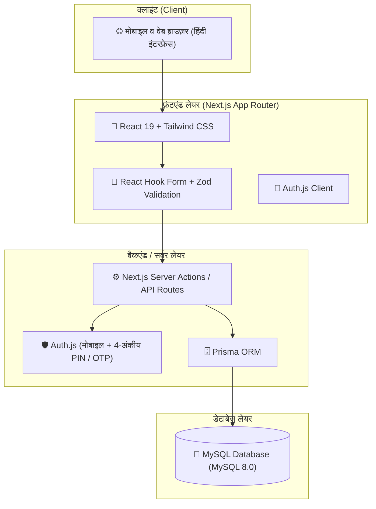

# 🌾 गन्ना हाट (GannaHaat) — Sugarcane Bidding Platform
## Phase 0: Project Scope Freeze (MVP) — अंतिम स्वीकृत स्कोप

ग्रामीण भारत के गन्ना किसानों और गुड़/खांडसारी/चीनी मिल खरीदारों के लिए पूर्णतः हिंदी में डिजिटल बोली एवं नीलामी मंच।

---

### 1. सिस्टम आर्किटेक्चर (System Architecture)

---

### 2. स्वीकृत टेक स्टैक (Frozen Tech Stack)

| घटक (Component) | तकनीक (Technology) | उद्देश्य |
|---|---|---|
| **फ़्रेमवर्क** | **Next.js (App Router)** | सर्वर-साइड रेंडरिंग, तेज़ गति और SEO |
| **भाषा** | **TypeScript** | टाइप सेफ्टी और मजबूत कोडबेस |
| **स्टाइलिंग** | **Tailwind CSS** | मोबाइल-प्रथम, बड़े टच-टारगेट और ग्रामीण सुलभ UI |
| **डेटाबेस** | **MySQL (8.0)** | विश्वसनीय रिलेशनल डेटाबेस |
| **ORM** | **Prisma** | टाइप-सेफ डेटाबेस मॉडल और माइग्रेशन |
| **प्रमाणीकरण (Auth)** | **Auth.js (NextAuth)** | मोबाइल नंबर + 4-अंकीय पिन / त्वरित मॉक OTP |
| **भाषा समर्थन (i18n)** | **द्विभाषी: हिंदी (डिफ़ॉल्ट) / English** | त्वरित भाषा स्विच (Navbar Toggle), ग्रामीण किसानों के लिए हिंदी व मिलों/व्यापारियों के लिए English |
| **वैलिडेशन** | **Zod** | फॉर्म इनपुट व स्कीमा सत्यापन |
| **फॉर्म हैंडलिंग** | **React Hook Form** | सुगम व तीव्र फॉर्म सबमिशन |
| **वर्जन कंट्रोल व डिप्लॉयमेंट** | **Git + GitHub + Vercel** | सतत परिनियोजन (CI/CD) |

---

### 3. उपयोगकर्ता भूमिकाएँ और फ़ीचर स्कोप (Feature Scope Matrix)

#### 🌾 1. किसान (Farmer)
1. **पंजीयन व लॉगिन (Register / Login):** 
   - मोबाइल नंबर और 4-अंकीय पिन या त्वरित मॉक OTP आधारित सरल लॉगिन।
2. **प्रोफ़ाइल (Profile):** 
   - नाम, गाँव, पंचायत, तहसील, ज़िला, मोबाइल नंबर।
3. **गन्ना लिस्टिंग प्रबंधन (Listing Management):**
   - **नई लिस्टिंग बनाएं:** गन्ने की बिक्री के लिए प्रविष्टि।
   - **संशोधन व हटाना:** फसल की जानकारी बदलना या लिस्टिंग बंद करना।
   - **मात्रा (Quantity):** क्विंटल / ट्रॉली में कुल मात्रा।
   - **किस्म व गुणवत्ता (Variety/Quality):** गन्ने की किस्म (उदा. Co 0238, Co 0118, Co 15023 आदि) एवं कटाई की स्थिति (ताजा कटा / 24 घंटे पुराना)।
   - **खेत का स्थान (Location):** गाँव, ब्लॉक, ज़िला।
   - **अपेक्षित न्यूनतम भाव (Expected/Base Price):** न्यूनतम दर (₹ प्रति क्विंटल)।
4. **प्राप्त बोलियाँ देखना (View Received Bids):** 
   - खरीदारों द्वारा लगाई गई सभी बोलियों की सूची (दर ₹/क्विंटल, खरीदार का नाम, कुल राशि)।
5. **बोली स्वीकार / अस्वीकार (Accept / Reject Bid):** 
   - उपयुक्त भाव मिलने पर किसान बोली स्वीकार (Accept) या अस्वीकार (Reject) कर सकता है।

---

#### 🏢 2. खरीदार / व्यापारी / मिल (Buyer)
1. **पंजीयन व लॉगिन (Register / Login):** 
   - व्यापारिक नाम / मिल का नाम, संपर्क व्यक्ति, मोबाइल नंबर + 4-अंकीय पिन।
2. **गन्ना लिस्टिंग्स देखना (Browse Listings):** 
   - सभी सक्रिय एवं एडमिन द्वारा स्वीकृत गन्ने की लिस्टिंग्स देखना।
3. **सर्च व फ़िल्टर (Search / Filter):** 
   - ज़िला, गन्ने की किस्म, मात्रा, और भाव अनुसार फ़िल्टर।
4. **लिस्टिंग का विस्तार विवरण (Listing Details):** 
   - फसल का पूर्ण ब्यौरा, स्थान, आधार भाव, कुल मात्रा।
5. **बोली लगाना (Place Bid):** 
   - आधार भाव से अधिक या बराबर अपनी प्रति क्विंटल दर दर्ज करना।
6. **मेरी बोलियाँ (My Bids Dashboard):** 
   - अपने द्वारा लगाई गई सभी सक्रिय व पुरानी बोलियाँ देखना।
7. **बोली स्थिति (Bid Status Tracking):** 
   - स्थिति: **प्रतीक्षारत (Pending)**, **स्वीकृत (Accepted)**, या **अस्वीकृत (Rejected)**।

---

#### 🛡️ 3. व्यवस्थापक (Admin)
1. **एडमिन लॉगिन (Admin Auth):** 
   - सुरक्षित व्यवस्थापक लॉगिन।
2. **उपयोगकर्ता प्रबंधन (Users Management):** 
   - किसानों और खरीदारों की सूची देखना, स्टेटस एक्टिव/ब्लॉक करना।
3. **लिस्टिंग अनुमोदन (Listings Approve / Reject):** 
   - किसानों द्वारा पोस्ट की गई नई लिस्टिंग्स का सत्यापन व अप्रूवल ताकि फर्जी प्रविष्टियां रोकी जा सकें।
4. **बोली निगरानी (Bids Monitor):** 
   - मंडी में चल रही सभी बोलियों और स्वीकार किए गए सौदों की निगरानी।
5. **मूल डैशबोर्ड (Basic Dashboard):** 
   - कुल किसान, कुल खरीदार, सक्रिय लिस्टिंग्स, कुल बोलियाँ और औसत भाव के आंकड़े।

---

### 4. प्रोजेक्ट रोडमैप (Implementation Roadmap)

- [x] **Phase 0:** प्रोजेक्ट स्कोप फ़्रीज़ एवं आवश्यकता विश्लेषण (Project Scope Freeze)
- [ ] **Phase 1:** आर्किटेक्चर एवं एनवायरनमेंट सेटअप (Next.js, TypeScript, Tailwind, Prisma, MySQL)
- [ ] **Phase 2:** डेटाबेस स्कीमा और ऑथेंटिकेशन (Auth.js + 4-digit PIN / OTP)
- [ ] **Phase 3:** किसान मॉड्यूल (प्रोफ़ाइल, लिस्टिंग CRUD, बोलियाँ देखना, स्वीकार/अस्वीकार)
- [ ] **Phase 4:** खरीदार मॉड्यूल (ब्राउज़, सर्च/फ़िल्टर, बोली लगाना, स्थिति ट्रैक)
- [ ] **Phase 5:** एडमिन मॉड्यूल (यूज़र प्रबंधन, लिस्टिंग अप्रूवल, मॉनिटरिंग डैशबोर्ड)
- [ ] **Phase 6:** टेस्टिंग, पॉलिशिंग एवं Vercel डिप्लॉयमेंट तैयारी
